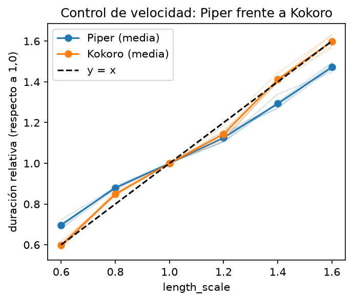
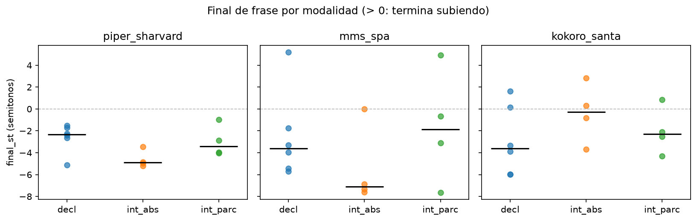
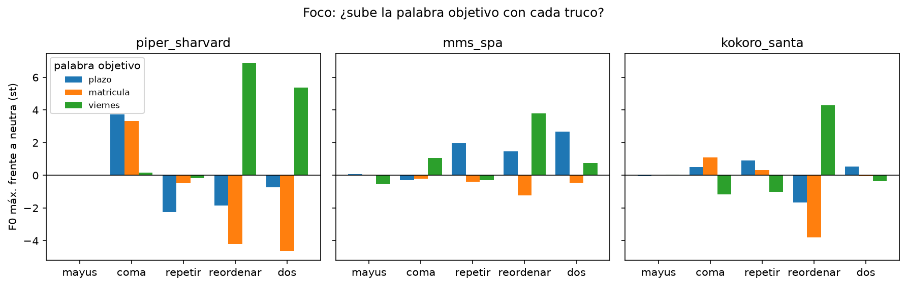
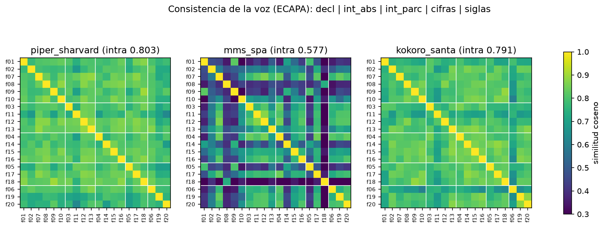

# Práctica 1 — Síntesis de voz

**Equipo 6** · Dominio: asistente de voz de la secretaría universitaria (atención al estudiante)

Integrantes: Álvaro Zarzuela Moncada, Miryam Merchán León, Sergio Velázquez López y Tomás Estrada Gómez

---

## 1. Resumen

Para el asistente de secretaría recomendamos **Kokoro-82M con la voz `em_santa`**, pasando antes el texto por nuestra función `normaliza()`. Las cifras que lo justifican:

- **0 fallos reales de inteligibilidad en las 20 frases.** Su WER de habla normal es 0,029, y todo lo que cuenta como error resultó ser de convención («de 9 a 2», «donde» sin tilde). Piper y MMS tienen 3 fallos reales cada uno. Con 14 frases de habla normal, la ventaja frente a Piper no es estadísticamente concluyente; frente a MMS sí pesan sus fallos en las siglas.
- **RTF mediano de 0,26 en CPU** (0,85 s por frase) y 0,042 en GPU. Es el más lento de los tres en CPU, pero sigue siendo casi cuatro veces más rápido que el tiempo real, y con GPU queda empatado con los otros dos.
- **Pesos con licencia Apache-2.0**, que permiten el uso en un servicio de la universidad. MMS, en cambio, es CC BY-NC y queda fuera.

Además mantiene la misma voz en todas las frases (similitud ECAPA intra de 0,79) y su control de velocidad es casi exacto. El precio es la memoria: ocupa 1,1 GB de RAM frente a los 0,1 GB de Piper, que sería la alternativa si hubiera que montarlo en una máquina muy justa. Ninguno de los tres sabe entonar una pregunta de sí o no ni enfatizar una palabra, y eso es una limitación para cualquier elección. El MOS todavía está pendiente de las notas de los otros equipos (sección 5.2).

## 2. Candidatos

Elegimos tres sistemas de dos familias distintas: Piper y MMS son VITS, y Kokoro es StyleTTS 2.

| | Piper (`es_ES-sharvard-medium`) | MMS-TTS (`facebook/mms-tts-spa`) | Kokoro-82M (`em_santa`) |
|---|---|---|---|
| Arquitectura | VITS exportado a ONNX | VITS (transformers) | StyleTTS 2 + iSTFTNet |
| Licencia del código | GPL-3.0 (piper-tts 1.8.0) | Apache-2.0 (transformers) | Apache-2.0 (kokoro 0.9.4); para español tira de phonemizer y espeak-ng, que son GPL-3.0 |
| Licencia de la voz/pesos | CC BY 3.0 | CC BY-NC 4.0 | Apache-2.0 |
| Uso comercial | Sí, citando la voz | **No** | Sí |
| Español | es_ES, 2 voces (H y M); usamos la de hombre | «spa» sin especificar variedad; datos de lecturas del Nuevo Testamento | Variedad no documentada; los fonemas de eSpeak son de es_ES (con θ). 3 voces |
| Tamaño en disco | 77 MB | 145 MB (36,3 M parámetros) | 327 MB (81,8 M parámetros) |
| RAM al cargar / pico | +99 MB / +189 MB | +341 MB / +458 MB | +1140 MB / +1165 MB |
| VRAM modelo / pico | ~0,8 GB según `nvidia-smi` (incluye el contexto CUDA de onnxruntime) | 142 MB / 231 MB | 317 MB / 631 MB |
| RTF mediano CPU / GPU | 0,040 / 0,034 | 0,172 / 0,044 | 0,260 / 0,042 |
| Mantenimiento | 1.8.0, sep. 2026, varias versiones este verano | Pesos de 2023; el repositorio de fairseq se archivó en mar. 2026 | 0.9.4, abr. 2025 |
| Parámetros prosódicos | `length_scale`, `noise_scale`, `noise_w_scale` | Ninguno | `speed` |
| Calidad (S3) | WER normal 0,041 (3 fallos reales); intra 0,80; suena correcta pero algo robótica en siglas y a velocidad lenta | WER normal 0,032 (3 fallos reales, 2 graves en siglas); intra 0,58; no normaliza nada y cambia de voz entre frases | WER normal 0,029 (0 fallos reales); intra 0,79; la más natural al oído |

**Por qué Kokoro como tercer candidato.** Queríamos una arquitectura distinta a VITS, con licencia que permitiera el uso real y que funcionara en CPU. Kokoro cumple las tres cosas. De sus tres voces en español escuchamos `ef_dora`, `em_alex` y `em_santa` con las mismas frases. Nos quedamos con `em_santa` porque era la que mejor se oía: más grave y con más volumen.

**Descartes.**

- **Parler-TTS** (`parler-tts-mini-multilingual`): admite español y permite describir con texto la voz que se quiere, lo que habría sido interesante para el control prosódico. No se puede instalar en el entorno de la práctica. Al pedírselo a pip con las versiones del entorno fijadas, responde `ResolutionImpossible`: *«parler-tts 0.2.3 depends on transformers<=4.46.1 and >=4.46.1 / The user requested (constraint) transformers==5.19.0»*. Exige exactamente la versión 4.46.1 de transformers, y el entorno, igual que NIMROD, usa la 5.x, de la que depende MMS. Bajarla para todo el cuaderno habría puesto en riesgo a los otros candidatos, así que lo descartamos.
- **XTTS-v2** (Coqui): no lo llegamos a instalar. El enunciado documenta que en este entorno falla con tres conflictos de dependencias encadenados, y además su licencia (Coqui Public Model License) no permite el uso comercial, así que tampoco serviría para el asistente.

Con los candidatos que sí funcionan tuvimos dos problemas en Windows que nos costaron tiempo y que dejamos resueltos en `adaptadores.py`. El primero: Piper y Kokoro cerraban el kernel cuando la ruta del proyecto tenía tildes, porque espeak-ng no encontraba sus datos. El segundo: Windows bloqueaba la DLL de spacy. Por último, de Kokoro descartamos las voces `ef_dora` y `em_alex` después de escucharlas.

**MMS** funciona, pero su licencia no comercial ya lo pone en duda para un servicio real. Lo mantenemos en la comparación porque es justo el contraejemplo útil: un modelo sin normalización de texto y entrenado con un tipo de habla muy distinto al de una secretaría.

## 3. Velocidad y recursos

### 3.1 Cómo se mide

`medir_rtf` carga el modelo aparte, hace una síntesis de calentamiento que no cuenta y toma la mediana de las 20 frases. Las tres reglas tienen su motivo:

- **La carga va aparte.** Un modelo se carga una vez y luego sintetiza cientos de frases. Si se mezcla con el RTF, el resultado depende de cuántas frases se midan. Con nuestros datos, para una sola frase Piper tarda más en total que MMS (4,0 s frente a 2,3 s), pero a partir de 5 frases ya es más rápido que MMS, y a partir de 4 más rápido que Kokoro.
- **Se descarta la primera síntesis.** La primera llamada reserva memoria e inicializa cosas que luego se reutilizan. Lo comprobamos sintetizando la misma frase 8 veces: en Piper la primera tardó unas 3 veces más que las demás, en MMS 1,5 veces y en Kokoro 1,2 veces.
- **Se usa la mediana.** Las interrupciones (otro proceso, el antivirus...) solo pueden hacer que una medida salga más lenta, nunca más rápida. Con la media, un solo caso así sube el resultado; con la mediana no.

### 3.2 Resultados en CPU

Portátil con CPU de 16 núcleos (`resultados/velocidad.csv`):

| | RTF mediano (p25-p75) | Síntesis por frase | Carga |
|---|---|---|---|
| Piper | 0,040 (0,039-0,041) | 0,11 s | 3,92 s |
| MMS | 0,172 (0,168-0,185) | 0,69 s | 1,58 s |
| Kokoro | 0,260 (0,256-0,267) | 0,85 s | 1,47 s |

Los tres valen para tiempo real. Piper es unas 25 veces más rápido que el tiempo real, 4 veces más que MMS y 6,5 más que Kokoro. A cambio es el que más tarda en cargar. Cambiar el número de hilos no lo arregla: el tiempo se va en crear la sesión de onnxruntime.

**Memoria.** En el portátil no hay CUDA, así que medimos la RAM del proceso con psutil. Cada modelo se cargó en un proceso aparte, con las librerías ya importadas, y el pico se tomó durante 3 síntesis de la frase más larga. Kokoro es con diferencia el que más ocupa: 1,1 GB frente a 0,1 GB de Piper.

### 3.3 CPU frente a GPU

No pudimos trabajar en NIMROD. Con permiso del profesor, la parte de GPU se midió en un segundo portátil con una NVIDIA RTX 4060 Laptop (8 GB), ejecutando las mismas celdas (`resultados/*_gpu.csv` y `velocidad_cpu_gpu.csv`).

| | RTF GPU (p25-p75) | Síntesis por frase | Carga | Ganancia frente a nuestra CPU |
|---|---|---|---|---|
| Piper | 0,034 (0,028-0,037) | 0,10 s | 1,20 s | 1,2× |
| MMS | 0,044 (0,038-0,059) | 0,17 s | 1,26 s | 3,9× |
| Kokoro | 0,042 (0,035-0,052) | 0,15 s | 1,72 s | 6,2× |

**La GPU no gana siempre.** MMS y Kokoro, que son modelos PyTorch más pesados, mejoran 4 y 6 veces, y en GPU los tres quedan casi empatados. Piper apenas mejora (de 0,040 a 0,034). El modelo es pequeño, las frases son cortas, hay que mover los datos a la GPU y traerlos de vuelta, y la fonetización con eSpeak sigue haciéndose en CPU. Además ocupa unos 0,8 GB de una GPU que en un servidor se comparte con otros usuarios.

Hay que matizarlo porque todo depende de con qué CPU se compare. En la CPU del segundo portátil Piper dio un RTF de 0,549, unas 14 veces más lento que en la nuestra, y allí la GPU sí le saca 16 veces. Con una CPU buena, a Piper no le compensa la GPU. Los tiempos de carga entre portátiles no los comparamos, porque dependen del disco de cada uno.

Memoria en GPU: MMS y Kokoro medidos con `torch.cuda.memory_allocated()`, que solo cuenta los tensores de PyTorch. Piper no usa PyTorch, así que su dato sale de `nvidia-smi`: la memoria usada subió de unos 1030 a 1830 MiB al sintetizar. Incluso Kokoro, el más grande, se queda por debajo de 0,7 GB de pico.

## 4. Control prosódico

### 4.1 Linealidad de la velocidad (2.1)

| length_scale | 0,6 | 0,8 | 1,0 | 1,2 | 1,4 | 1,6 |
|---|---|---|---|---|---|---|
| Duración relativa, Piper | 0,69 | 0,88 | 1,00 | 1,12 | 1,28 | 1,47 |
| Duración relativa, Kokoro | 0,60 | 0,85 | 1,00 | 1,14 | 1,41 | 1,60 |

Medias de las 6 declarativas. **Piper no sigue la diagonal y se queda corto por los dos lados**: con 0,6 la frase solo se acorta un 31 % y con 1,6 solo se alarga un 47 %. Las seis frases dan prácticamente lo mismo, así que es un comportamiento del modelo y no de la frase. Si se quiere una velocidad concreta, hay que calibrarla probando valores. **Kokoro sí sigue la diagonal** en los extremos (0,60 y 1,60), y en los valores intermedios se aparta poco. Tiene sentido, porque divide directamente entre `speed` la duración que predice para cada fonema.

En cuanto a los silencios, en Piper el alargamiento está casi todo en los sonidos: la voz sola crece 1,44 frente a 1,47 de la frase entera. En Kokoro las pausas crecen mucho más que la voz (de 0,04 a 0,30 s con 1,6). Como nuestras frases no tienen comas, sospechamos que buena parte de esos «huecos» son cierres de oclusivas que al alargarse superan los 50 ms del umbral. Al oído, los dos fallan por lados opuestos. Piper suena arrastrada y robótica a partir de 1,4, pero aguanta bien rápido. Kokoro a 0,6 se come el «La» inicial (el límite está en torno a 0,8), y en cambio despacio suena incluso mejor que a velocidad normal. MMS no tiene control de velocidad.

### 4.2 Determinismo y variabilidad (2.2)

La misma frase (f01) 5 veces en cada condición:

| | Duración media | Desv. duración | Rango F0 p5-p95 (st) | ¿5 audios iguales? |
|---|---|---|---|---|
| Piper, defecto (0,667 / 0,8) | 2,27 s | 1,5 % | 9,65 | No |
| Piper, ruido cero | 2,23 s | 0 | 11,78 | Sí, muestra a muestra |
| Piper, ruido alto (1 / 1) | 2,29 s | 1,2 % | 10,72 | No |
| MMS | 3,67 s | 6,7 % | 9,69 | No |
| Kokoro | 2,43 s | 0 | 13,59 | Casi (`dif_max` = 0,15) |

Piper es determinista solo con el ruido a cero, y por eso lo pusimos así en la 2.4. Kokoro se comporta como determinista en duración y entonación, aunque los ficheros no son idénticos bit a bit. **MMS es el más variable**: la duración va de 3,44 a 4,00 s y no tiene ningún parámetro para fijarla. Esto condiciona todo lo que medimos después en MMS con una sola realización.

Quitar el ruido no hace a Piper más monótono: el rango de F0 con ruido cero es incluso algo mayor, y al escucharlas no se nota diferencia. Por el camino aprendimos a no fiarnos del rango máximo-mínimo de F0. En MMS daba 27 st de media porque el detector saltaba de octava en 4 de las 5 repeticiones. Con el rango entre los percentiles 5 y 95 queda en 9,7 st, en línea con los otros dos.

### 4.3 Modalidad: ¿pregunta el sistema cuando debe? (2.3)

Mediana de `final_st` (movimiento de los últimos 300 ms, en semitonos):

| | Misma frase con «.» | con «¿?» | con «¡!» | Corpus: decl | int_abs | int_parc |
|---|---|---|---|---|---|---|
| Piper | −3,05 | −4,20 | −4,32 | −3,19 | −2,33 (1 de 4 sube) | −3,06 |
| MMS | +3,30 | −1,03 | +1,60 | −3,54 | −5,62 (1 de 4) | −3,61 |
| Kokoro | −4,89 | −4,54 | −5,30 | −3,55 | −0,33 (2 de 4) | −2,39 |

**Ningún sistema hace la subida final de la interrogativa absoluta.** Piper y Kokoro ignoran los signos: las tres versiones de la misma frase tienen casi el mismo contorno, la misma duración y el mismo tono (`modalidad_piper_sharvard.png`, `modalidad_kokoro_santa.png`). Al oído suenan igual. Kokoro es el que más se acerca en el corpus, porque sus int_abs quedan casi planas en vez de bajar, pero no llegan a sonar a pregunta. Las parciales bajan como las declarativas, lo que en español es normal, aunque eso no demuestra que el sistema distinga los dos tipos de pregunta.

MMS es el único en el que se oye algo distinto con «¿?», sobre todo un cambio de ritmo (3,2 s frente a 3,5 s). Pero `final_st` no lo recoge: la declarativa le sale «subiendo» y la pregunta varía de −3,6 a +10,5 entre repeticiones. Las subidas de +12 y +13 st en f13 y f07 (¡esta última una declarativa!) son saltos del detector de F0.

Para el asistente esto pesa: «¿Tiene ya el certificado de notas?» va a sonar a afirmación con cualquiera de los tres.

### 4.4 Foco: ¿se puede enfatizar una palabra? (2.4)

Frase «El plazo de matrícula termina el viernes.», intentando enfatizar *plazo*, *matrícula* y *viernes* con cinco trucos de texto. Medimos el cambio de F0 máxima (percentil 90) de la palabra respecto a la versión neutra, localizándola con Whisper `small`.

- **Mayúsculas:** no hacen nada. En Piper el audio es idéntico al neutro.
- **Coma:** es lo único que se oye. Mete una pausa, y en Piper la palabra anterior sube 3-4 st y se alarga (*plazo* un 33 %). Pero eso es el alargamiento típico antes de una pausa, no énfasis: la coma parte la frase en dos grupos.
- **Repetir:** la palabra repetida no sube ni se alarga.
- **Reordenar y partir en dos oraciones:** mueven mucho la F0 (*viernes* al principio sube de 4 a 7 st), pero por la posición. Es la declinación: el tono baja a lo largo de la frase y vuelve a arrancar alto en cada oración nueva.
- **MMS:** varía tanto entre ejecuciones que sus cambios de hasta ±2,7 st no se pueden interpretar.

**Ninguno permite enfatizar una palabra desde el texto.** Solo se controla la estructura de la frase. Un «el VIERNES, no el lunes» no se puede marcar con la voz.

### 4.5 Normalización de texto (2.5)

Con el texto original, Piper y Kokoro pasan por eSpeak, que convierte las cifras de forma literal («treinta barra cero nueve», «catorce cero cero»). MMS no normaliza nada: su tokenizador elimina `/`, `:` y `,`, de modo que recibe «el 3009 a las 1400». Como se entrenó con lecturas de la Biblia, nunca aprendió a decir dígitos y produce algo ininteligible. Los fallos de Piper y Kokoro son de convención (se entiende, pero no se dice así); los de MMS son fallos reales.

Nuestra `normaliza()` convierte fechas («treinta de septiembre»), horas en formato de 12 h con franja («las dos de la tarde»), importes («veintiséis con treinta euros») y siglas. Las siglas se deletrean, salvo ETSI y UHU, que se leen como palabra. Sigue exactamente la convención de la columna `leida`: las 20 frases normalizadas coinciden con ella.

| | Cifras (f05, f17, f18) | Siglas (f06, f19, f20) |
|---|---|---|
| Piper | Mejoran las tres | Mejora DNI; TFG y PDF igual |
| MMS | Arregladas: de ininteligible a correcto | Mejoran TFG y PDF; DNI sigue sin entenderse |
| Kokoro | Arregladas | **Empeoran** TFG y DNI: eSpeak ya las deletreaba bien, y «te efe ge» hace que las acentúe como palabras sueltas |

Mejora o iguala en 16 de las 18 combinaciones, así que la Sesión 3 se hizo con el texto normalizado. Normalizar solo las cifras para Kokoro habría sido mejor para Kokoro, pero entonces cada sistema leería un texto distinto y la comparación dejaría de ser justa.

## 5. Calidad

### 5.1 Inteligibilidad

Reconocedor de referencia Whisper large-v3, el mismo para todos los equipos, sobre los audios del texto normalizado (`resultados/inteligibilidad.csv`). Para comparar, también lo pasamos por los audios originales.

**Convención de la columna `leida`.** Escribimos cada frase como la diría en voz alta una persona de la secretaría: todo en letras, sin puntuación y en minúsculas. Las fechas van con el nombre del mes («treinta de septiembre»). Las horas, en formato de 12 h con la franja («a las dos de la tarde»), porque «a las dos» a secas es ambiguo y nadie dice «a las catorce» en una ventanilla. Los importes llevan «con» («veintiséis con treinta euros»). Las siglas que en España se deletrean se escriben letra a letra («te efe ge», «de ene i», «pe de efe»), y las que se pronuncian como palabra se escriben como palabra («etsi»). La idea es que `leida` sea la pronunciación correcta, no lo que un reconocedor suele escribir. Por eso sabíamos de antemano que en cifras y siglas iba a haber mucho desacuerdo de convención.

| WER medio | Habla normal (14 frases) | Cifras + siglas, original | Cifras + siglas, normalizado |
|---|---|---|---|
| Piper | 0,041 | 0,440 | 0,329 |
| MMS | 0,032 | 0,477 | 0,338 |
| Kokoro | 0,029 | 0,421 | 0,291 |

**Clasificación de los 18 casos de cifras y siglas** (revisados uno a uno; los dudosos, escuchándolos):

| Frase | Piper | MMS | Kokoro |
|---|---|---|---|
| f05 fecha y hora | artefacto («30», «2») | artefacto | artefacto |
| f06 TFG / ETSI | **fallo real**: «entregue» se oye mal | **fallo real**: «tfk en la ex y» | artefacto («TFG», «Etsy») |
| f17 importe | artefacto («26,30») | artefacto | artefacto |
| f18 fecha y hora | artefacto («10 y 40 y 5») | artefacto | artefacto |
| f19 DNI | artefacto: se oye bien, Whisper escribe «Dreneri» | **fallo real**: «acunte», «DNA» | artefacto («DNI») |
| f20 PDF | artefacto («PDF») | artefacto | artefacto |

En las cifras, los 9 «errores» son del tipo «30» frente a «treinta»: las voces lo dicen bien y Whisper lo escribe con números. En siglas, 6 de 9 también son artefactos. **En total son 15 artefactos y 3 fallos reales** (2 de MMS y 1 de Piper). El WER de 0,29-0,34 en estas categorías apenas dice nada de cómo se entienden, y no se puede comparar entre sistemas sin esta revisión.

En el habla normal también hay artefactos: «de 9 a 2» en f01, y «donde» frente a «dónde» en Kokoro, porque la comparación no quita las tildes. Los fallos reales son «consejería» por «conserjería» (f02, en Piper y MMS) y «cuatimestre» (f07, en Piper). **Descontando los artefactos, el WER de habla normal queda en 0 para Kokoro, 0,012 para MMS y 0,021 para Piper.** Los tres se entienden muy bien, y Kokoro no tiene ni un fallo real.

Para saber si esas diferencias son reales, calculamos el intervalo de confianza del 95 % por bootstrap sobre las 14 frases (`resultados/inteligibilidad_ic95.csv`):

| WER de habla normal | Bruto | Corregido (solo fallos reales) |
|---|---|---|
| Piper | 0,041 [0,000-0,091] | 0,021 [0,000-0,051] |
| MMS | 0,032 [0,000-0,082] | 0,012 [0,000-0,036] |
| Kokoro | 0,029 [0,000-0,079] | 0,000 [0,000-0,000] |

Los intervalos se solapan casi por completo, así que **con 14 frases no podemos afirmar que un sistema se entienda mejor que otro** en el habla normal. Lo que sí podemos decir es que los tres se entienden muy bien. El intervalo [0-0] de Kokoro no significa que nunca vaya a fallar: no ha fallado en ninguna de las 14 frases, y el bootstrap no puede generar errores que no existen. La diferencia que sí pesa está en las siglas (sección anterior), donde MMS falla de verdad en dos de tres.

Un detalle que muestra el problema de medir MMS una sola vez: su WER de habla normal es 0,044 en una tabla y 0,032 en la otra, aunque el texto de esas frases es el mismo. La diferencia es solo que se sintetizaron en dos momentos distintos.

### 5.2 MOS

**Protocolo.** Elegimos 5 frases, una de cada categoría: f01 (decl), f03 (int_abs), f04 (int_parc), f05 (cifras) y f06 (siglas), con el texto normalizado. Con los tres sistemas son 15 muestras. `preparar_mos()` las renombró de forma aleatoria (`E6_01` a `E6_15`) para que el oyente no sepa qué sistema escucha, y la clave quedó en `mos_clave.json`, sin compartir hasta recibir las notas. Las puntúan los otros equipos del turno, con auriculares y en la escala 1-5 del enunciado. Cada muestra debe recibir al menos 5 notas de personas distintas. El MOS por sistema se calcula con `analiza_mos()`, con un intervalo de confianza del 95 % por bootstrap.

| | MOS | IC 95 % | Nº de notas |
|---|---|---|---|
| Piper | _pendiente_ | | |
| MMS | _pendiente_ | | |
| Kokoro | _pendiente_ | | |

_[Pendiente de recibir las notas de los otros equipos. Al interpretarlo: si los intervalos de dos sistemas se solapan de forma apreciable, no se puede decir que uno sea mejor que el otro.]_

### 5.3 Consistencia de la voz

Verificador de locutor ECAPA-TDNN sobre los mismos audios. La similitud coseno vale 1 cuando parece el mismo locutor.

| | Intra (entre sus 20 frases) | Decl-decl | Int-int | Decl-int |
|---|---|---|---|---|
| Piper | 0,803 | 0,808 | 0,813 | 0,813 |
| Kokoro | 0,791 | 0,786 | 0,806 | 0,797 |
| MMS | 0,577 | 0,473 | 0,706 | 0,565 |

Entre sistemas, la similitud queda entre −0,04 y 0,06: son tres voces claramente distintas. Piper y Kokoro tienen una identidad bien definida.

Intervalos de confianza del 95 % de la intra, por bootstrap (`resultados/consistencia_ic95.csv`). Se remuestrean frases y no pares, porque cada frase aparece en 19 pares y estos no son independientes. Los resultados son Piper 0,803 [0,780-0,825], Kokoro 0,791 [0,764-0,817] y MMS 0,577 [0,494-0,671]. **MMS queda claramente por debajo, sin solape.** Entre Piper y Kokoro los intervalos se solapan, así que no podemos decir que uno sea más consistente que el otro.

**¿Cambia la identidad cuando pregunta? No, en ninguno.** Decl-int queda igual o por encima de decl-decl. La diferencia decl-int menos decl-decl, con su intervalo, es +0,005 [−0,026; +0,032] en Piper, +0,011 [−0,035; +0,042] en Kokoro y +0,092 [−0,060; +0,184] en MMS. En los tres el intervalo contiene el 0. Pero en el corpus las preguntas tienen palabras distintas a las declarativas, y ECAPA también reacciona al contenido. Por eso lo comprobamos con los audios de la 2.3, donde lo único que cambia es el signo:

| | Misma versión, 5 repeticiones | Decl frente a int | Decl frente a excl |
|---|---|---|---|
| Piper | 0,911 | 0,911 | 0,906 |
| Kokoro | 0,996 | 0,974 | 0,976 |
| MMS | 0,877 | 0,884 | 0,881 |

Cambiar el punto por una interrogación deja la similitud donde está la de repetir la misma frase. Kokoro baja algo más, pero solo porque es determinista y sus repeticiones son casi idénticas; 0,974 sigue siendo muy alto. Cuadra con la 2.3: si los sistemas apenas cambian la entonación al preguntar, tampoco tienen por qué cambiar de voz.

**MMS cambia de voz según la frase.** Con la misma frase es estable (0,877), pero entre frases distintas baja a 0,577. f18 es la más rara: 0,30 de media con las demás. Al escuchar f01, f08, f15 y f18, f08 y f18 parecían una persona y f01 y f15 otra, más aguda y con menos ruido de fondo. ECAPA dice exactamente lo mismo: los pares más parecidos de esas cuatro son f08-f18 (0,74) y f01-f15 (0,55), y los cruzados quedan entre 0,23 y 0,47. La F0 mediana casi no cambia (142 Hz en f18 frente a 150 Hz en f15), así que lo que varía es el timbre y la forma de hablar. Como repitiendo la misma frase es estable, no es el azar de cada síntesis: es el texto el que empuja al modelo hacia una u otra manera de hablar. Nuestra explicación, que no hemos podido comprobar, es que MMS se entrenó con un habla muy distinta (lectura bíblica) y con frases de secretaría, fuera de lo que conoce, no mantiene un estilo fijo.

## 6. Discusión

**Donde coinciden.** Con lo que tenemos hasta ahora (inteligibilidad revisada a mano, consistencia y lo que oímos), MMS sale peor. Tiene los fallos de inteligibilidad más graves (las siglas de f06 y f19), cambia de voz de una frase a otra y es el que peor sonaba al escucharlo en la 2.5. Kokoro y Piper quedan cerca en consistencia, y Kokoro va algo por delante en inteligibilidad. Y lo que oímos al revisar las frases de MMS coincidió con lo que dijo ECAPA, lo que nos da cierta confianza en esa medida.

**Donde no coinciden, y por qué.**

- **El WER de habla normal no distingue a los sistemas, pero el oído y la consistencia sí.** Los tres están entre 0,029 y 0,041, con intervalos de confianza que se solapan casi por completo, y MMS sale incluso por delante de Piper. En cambio, la consistencia separa a MMS de los otros dos sin solape. El WER mide si Whisper reconstruye las palabras, y Whisper es muy bueno reconstruyendo palabras a partir de una voz mediocre. No mide si suena natural, si la voz es siempre la misma o si cansa escucharla. Que MMS saque buen WER y una consistencia de 0,58 no es una contradicción: son preguntas distintas.
- **El WER de cifras y siglas dice que la normalización ayuda a todos, y el oído dice que a Kokoro le empeora las siglas.** Whisper escribe «TFG» tanto si Kokoro lo deletrea con naturalidad como si lo dice como tres palabras sueltas, así que el WER no ve la diferencia. Al revés también pasa: el WER de cifras es altísimo para voces que las dicen perfectamente. Sin la revisión a mano, el WER de esas categorías habría llevado a conclusiones equivocadas.
- **En MMS, el oído y el WER se contradijeron en el TFG** (a nosotros nos sonaba mejor normalizado y Whisper lo transcribió peor). No creemos que ninguno de los dos se equivoque. Escuchamos una síntesis y Whisper transcribió otra, y MMS varía un 7 % en duración de una vez a otra. Con una sola realización por frase, cualquier medida de MMS es poco fiable.
- **`final_st` y el oído tampoco coincidieron en la modalidad de MMS** (2.3): se oía una diferencia que la medida no recogía, por los saltos del detector de F0. Pasa lo mismo que con el WER: una medida automática solo ve lo que está diseñada para ver.

**Qué esperamos del MOS.** Por lo que hemos oído, esperamos que Kokoro quede por encima y MMS por debajo, y que los intervalos de Kokoro y Piper puedan solaparse. Si sale así, el MOS confirmará la consistencia y el oído, y volverá a mostrar que el WER de habla normal no sirve para ordenar sistemas que ya se entienden bien. _[Revisar cuando lleguen las notas.]_

## 7. Decisión y limitaciones

### 7.1 Decisión

**Usaríamos Kokoro (`em_santa`) con `normaliza()` delante.** Repasando los cuatro criterios:

- **Calidad.** Es el único sin fallos reales de inteligibilidad, mantiene la voz estable y es el que mejor suena. Hay que ser honestos con el alcance: con 14 frases, su ventaja en WER sobre Piper no es estadísticamente concluyente. Lo que sí está claro es que supera a MMS en consistencia y en siglas, y que al oído es el más natural. Hay un matiz: normalizarle las siglas le perjudica. En producción se podría dejar que eSpeak deletreara las siglas y normalizar solo cifras y horas. En la comparación no lo hicimos para que todos los sistemas leyeran el mismo texto.
- **Velocidad.** Es el más lento en CPU (RTF 0,26), pero el asistente dice frases cortas, y 0,85 s por frase es una espera aceptable en una conversación de ventanilla. Si hubiera que atender a varios usuarios a la vez, con una GPU pasa a 0,15 s por frase y queda igual que los otros.
- **Recursos.** 1,1 GB de RAM o 0,63 GB de VRAM de pico. En un servidor de la universidad no es un problema.
- **Licencia.** Pesos Apache-2.0. La parte GPL (espeak-ng) es la misma que arrastra Piper. Si el asistente funciona como servicio desde un servidor, el programa no se distribuye y la GPL no impone nada más. Habría que revisarlo si algún día se empaquetara en una app.

**Piper sería la alternativa** si hubiera que ejecutarlo en una máquina pequeña sin GPU, por ejemplo un quiosco en la propia secretaría. Es 6,5 veces más rápido en CPU, ocupa diez veces menos y se entiende casi igual de bien. Lo pagaríamos en naturalidad y en un control de velocidad menos fiable.

**MMS lo descartamos** aunque funcione: su licencia no permite uso comercial, no normaliza nada, es el más variable y cambia de voz según la frase. Para un servicio de atención, que la «persona» del otro lado suene distinta de una respuesta a otra resulta desconcertante.

Queda un problema que no resuelve ninguno de los tres: **las preguntas de sí o no suenan a afirmación** y **no se puede enfatizar una palabra**. Para un asistente que pregunta «¿Tiene ya el certificado?» o avisa de que el plazo es «el viernes, no el lunes», habría que redactar las frases para no depender de la entonación, o buscar un sistema con control explícito de prosodia (SSML).

### 7.2 Limitaciones

- **Corpus pequeño.** 20 frases, y solo 3 por categoría en cifras y siglas. El foco se probó con una sola frase.
- **Una realización por frase.** Sobra en Kokoro, que es determinista, y en Piper es aceptable. En MMS no lo es: varía un 7 % en duración entre ejecuciones y sus medidas tienen un margen que no hemos cuantificado.
- **Hardware.** No usamos NIMROD. La CPU es la de un portátil y la GPU la de otro, y la propia comparación muestra que el resultado de Piper depende mucho de la CPU. La memoria en CPU es RAM medida con psutil, y la de Piper en GPU sale de `nvidia-smi`, que incluye el contexto CUDA. No es exactamente lo mismo que mide `memory_allocated()` en los otros dos.
- **WER.** Depende de la convención de `leida` y de cómo escribe Whisper. La comparación no quita tildes, y la clasificación entre artefacto y fallo real la hicimos nosotros, escuchando.
- **ECAPA.** Está entrenado con voces reales (VoxCeleb) y reacciona también al contenido y al ruido, no solo al locutor. Por eso controlamos con el mismo texto en la pregunta de la modalidad, pero en la intra general el contenido sigue influyendo.
- **Medidas de F0.** `final_st` solo mira los últimos 300 ms, y en MMS el detector salta de octava. Por eso escuchamos todo lo que medimos.
- **MOS.** Pendiente. Además, los oyentes serán estudiantes de la asignatura, que ya saben cómo suena una voz sintética y probablemente sean más severos que un usuario normal.

## 8. Reflexión ética

Antes de esta práctica habríamos dicho que las voces sintéticas abiertas ya no se distinguen de una persona. Después de escuchar unos cuantos cientos de audios no lo tenemos tan claro, y aun así nos preocupa más que antes.

¿Podrían engañar estas voces a alguien? Si estás avisado, no. Se notan en cosas muy concretas que hemos medido: preguntan como si afirmaran (2.3), no saben enfatizar una palabra (2.4), Piper se vuelve robótico al ralentizarlo y MMS cambia de timbre de una frase a otra (3.3). Hay incluso una pista que ninguna persona daría nunca: Kokoro dice la misma frase cinco veces y salen cinco audios casi idénticos. Pero los oyentes avisados éramos nosotros, con auriculares y buscando el fallo. Una frase corta y declarativa de Kokoro como «La secretaría abre de nueve a dos», escuchada por teléfono por alguien que no espera una máquina, pasaría sin problema. Los fallos aparecen en lo que el sistema no sabe hacer, y quien quiera engañar solo tiene que no pedírselo. Y nosotros solo hemos usado voces genéricas. Los sistemas de clonación van mucho más allá. Microsoft presentó VALL-E como capaz de imitar a una persona a partir de 3 segundos de su voz, y decidió no publicarlo por el riesgo de suplantación [1].

Esa suplantación ya ocurre. En 2019 el director de una empresa británica transfirió unos 220 000 euros porque creyó estar hablando por teléfono con su jefe, y era una voz sintética [2]. En enero de 2024, miles de votantes de New Hampshire recibieron llamadas con una imitación de la voz de Joe Biden que les pedía no votar en las primarias. A raíz de aquello, la FCC estadounidense declaró ilegales las llamadas automáticas con voces generadas por IA sin consentimiento [3]. Con un RTF de 0,04 como el de Piper, una sola CPU genera una hora de audio en menos de tres minutos, así que el problema no es solo que engañe, sino a cuánta gente a la vez.

Nos llamó la atención el consentimiento de las voces que hemos usado. MMS se entrenó con grabaciones de lecturas del Nuevo Testamento [4]. Esas personas leyeron un texto religioso para difundirlo, no para que su voz terminara diciendo «Entregue el TFG en la ETSI». De Kokoro ni siquiera se sabe con qué datos se entrenó, así que es imposible saber si alguien dio permiso. Que un modelo tenga licencia abierta no dice nada del consentimiento de quien puso la voz: la licencia la pone quien publica el modelo, no la persona grabada.

El caso de las personas fallecidas es todavía más delicado. En España lo vimos en 2021 con el anuncio de Cruzcampo que recreaba a Lola Flores, hecho con el permiso de sus hijas. La Ley Orgánica 1/1982 protege la voz igual que la imagen (art. 7.6) y permite que, tras la muerte, defiendan esos derechos las personas designadas en el testamento o los familiares (art. 4) [5]. Pero que la familia pueda autorizarlo no significa que la persona estuviera de acuerdo en decir palabras que nunca dijo. Con una voz sintética no se reproduce lo que alguien dijo, se fabrica lo que no dijo.

Como salvaguardas nos parecen razonables tres cosas. La primera es avisar siempre. El Reglamento europeo de IA obliga, desde agosto de 2026, a informar cuando alguien interactúa con un sistema de IA y a marcar de forma detectable el audio generado [6]. Nuestro asistente debería empezar diciendo que es una voz automática. La segunda son las marcas de agua en el propio audio, como AudioSeal [7]. Pero tienen un límite evidente que esta práctica deja claro: Piper y Kokoro se ejecutan en cualquier portátil, sin servidor de por medio, y nadie obliga a quien los usa a marcar nada. Por eso la tercera nos parece la más realista: dejar de confiar en la voz como prueba de identidad. Ni bancos ni secretarías deberían verificar a nadie por cómo suena al teléfono.

Nos quedamos con una conclusión incómoda. Lo que hace que estas voces sean útiles para un asistente (que se entiendan, que suenen siempre igual, que sean rápidas y gratuitas) es exactamente lo que las hace útiles para engañar. Lo que todavía las delata, la entonación, mejorará pronto, así que el aviso al oyente no puede depender de que se note.

**Fuentes**

[1] Wang, C. et al. (2023). *Neural Codec Language Models are Zero-Shot Text to Speech Synthesizers* (VALL-E). arXiv:2301.02111.
[2] Stupp, C. (2019, 30 de agosto). Fraudsters Used AI to Mimic CEO's Voice in Unusual Cybercrime Case. *The Wall Street Journal*.
[3] Federal Communications Commission (2024). *Declaratory Ruling* FCC 24-17, 8 de febrero de 2024 (voces generadas por IA en llamadas automáticas).
[4] Pratap, V. et al. (2023). *Scaling Speech Technology to 1,000+ Languages*. arXiv:2305.13516.
[5] Ley Orgánica 1/1982, de 5 de mayo, de protección civil del derecho al honor, a la intimidad personal y familiar y a la propia imagen. BOE núm. 115, arts. 4 y 7.6.
[6] Reglamento (UE) 2024/1689 del Parlamento Europeo y del Consejo, de 13 de junio de 2024 (Reglamento de Inteligencia Artificial), art. 50.
[7] San Roman, R. et al. (2024). *Proactive Detection of Voice Cloning with Localized Watermarking*. ICML 2024. arXiv:2401.17264.

## 9. Reparto del trabajo

| Integrante | Rol principal | De qué se ocupó |
|---|---|---|
| Álvaro Zarzuela Moncada | Corpus, texto y coordinación | Puesta en marcha y repositorio; redacción de `frases.tsv` (1.1); normalización de texto y `normaliza()` (2.5); revisión manual de artefactos y fallos reales (3.1); secciones 1, 6 y 7 del informe y entrega |
| Miryam Merchán León | Candidatos y prosodia | Búsqueda e integración de Kokoro como tercer candidato y elección de la voz (1.2); tiempo de carga, memoria y todas las medidas en GPU (1.3-1.4); modalidad (2.3) y foco (2.4); cuaderno final; secciones 2 y 4 del informe |
| Sergio Velázquez López | Sistemas y medidas acústicas | Registro de Piper y MMS (1.2); RTF y generación de los audios (1.4); linealidad de la velocidad (2.1) y determinismo (2.2); consistencia de la voz con ECAPA (3.3); sección 3 del informe |
| Tomás Estrada Gómez | Evaluación y estadística | Fichas de los candidatos: licencias, español y mantenimiento (1.3); WER con el reconocedor de referencia (3.1); preparación y análisis del MOS (3.2); reflexión ética (3.4); secciones 5 y 8 del informe |
| Los cuatro | | Convención de la columna `leida` (1.1), puntuación de las muestras MOS de los otros equipos (3.2) y decisión final |
